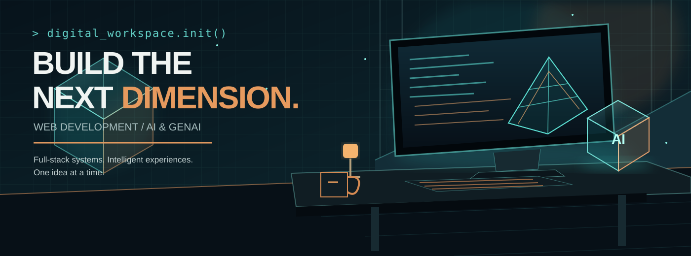

# VAIBHAV JHA

### Full-Stack Developer · Exploring AI & Generative AI

**Building for the Web. Exploring the Future of AI.**

[Portfolio](https://vaibhavjha.in) · [GitHub](https://github.com/jvaibhav08)

---

## 01 / About

I'm a web developer focused on building practical, user-friendly applications across the frontend and backend. I'm also expanding into **AI and Generative AI**, with an interest in bringing intelligent capabilities into real-world products.

- Building with **React, JavaScript, Node.js and Express**
- Working with **REST APIs, databases and full-stack architecture**
- Exploring **Python, LLMs, RAG and AI-powered application workflows**
- Interested in combining strong web fundamentals with emerging AI tools

## 02 / Tech Stack

## 03 / Selected Work

<table>
<tr>
<td width="50%" valign="top">

### Vehicle Management System

A full-stack application for managing vehicles, insurance records, PUC details and related reports.

**Stack:** React · Node.js · Express · MySQL

[View repository](https://github.com/jvaibhav08/vehicle-management-system)

</td>
<td width="50%" valign="top">

### React Portfolio

A personal developer portfolio built with React, with a focus on presenting projects and work.

**Stack:** React · JavaScript · Sanity

[View repository](https://github.com/jvaibhav08/React-Portfolio)

</td>
</tr>
</table>

## 04 / Currently Exploring

| AREA | FOCUS |
|:---|:---|
| Generative AI | LLM fundamentals and AI application patterns |
| Retrieval | RAG concepts and vector search |
| AI Engineering | API integrations and intelligent workflows |
| Backend | Scalable APIs, data modelling and system design |

## 05 / GitHub Activity

---

### BUILD · LEARN · EXPLORE

*Open to interesting ideas, collaborations and opportunities across web development and AI.*

